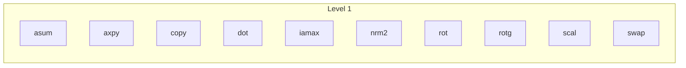

# L1

<!-- deps:begin -->
_Generated by `tools/depmap.mjs` from the source; the gate fails if this block and the code disagree. Do not edit by hand._

Families at this level and what each one's routines call, down to the leaves:

- **asum**: `dasum`, `dzasum`, `sasum`, `scasum`
- **axpy**: `caxpy`, `daxpy`, `saxpy`, `zaxpy`
- **copy**: `ccopy`, `dcopy`, `scopy`, `zcopy`
- **dot**: `cdotc`, `cdotu`, `ddot`, `sdot`, `zdotc`, `zdotu`
- **iamax**: `icamax`, `idamax`, `isamax`, `izamax`
- **nrm2**: `dnrm2`, `dznrm2`, `scnrm2`, `snrm2`
- **rot**: `crot`, `csrot`, `drot`, `srot`, `zdrot`, `zrot`
- **rotg**: `crotg`, `drotg`, `srotg`, `zrotg`
- **scal**: `cscal`, `csscal`, `dscal`, `sscal`, `zdscal`, `zscal`
- **swap**: `cswap`, `dswap`, `sswap`, `zswap`

<!-- deps:end -->
