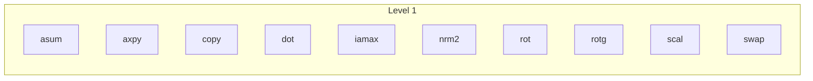

# Level 1 — vector operations

Ten families, one folder each, every routine in four number types
(`d` f64, `s` f32, `z` c64, `c` c32), plus the mixed-type forms
reference BLAS spells with two letters: the complex routines that
return a real (`dznrm2`, `scnrm2`, `dzasum`, `scasum`) and the complex
routines that take a real scalar (`zdscal`, `csscal`, `zdrot`,
`csrot`). Each folder's README is that family's chapter; this page is
the level's map and its scoreboard.

| family | operation | folder |
|---|---|---|
| axpy | $y \leftarrow \alpha x + y$ | `axpy/` |
| scal | $x \leftarrow \alpha x$ (complex: also a real $\alpha$) | `scal/` |
| copy | $y \leftarrow x$ | `copy/` |
| swap | $x \leftrightarrow y$ | `swap/` |
| dot | $x^{T} y$ (complex: unconjugated `dotu` and conjugated `dotc`) | `dot/` |
| nrm2 | $\|x\|_2$ | `nrm2/` |
| asum | $\sum_i |x_i|$ (complex: $\sum_i |\mathrm{re}\,x_i| + |\mathrm{im}\,x_i|$) | `asum/` |
| iamax | the first index of the largest $|x_i|$ (complex: of $|\mathrm{re}| + |\mathrm{im}|$) | `iamax/` |
| rot | apply a plane rotation to two vectors (complex: real or complex sine) | `rot/` |
| rotg | generate a plane rotation from two scalars | `rotg/` |

Vectors are contiguous slices (strides are todo S3, gated by decision
D7); two-vector routines return an `Error` when the lengths differ.

## Three shapes

Every Level 1 routine is one of three loops over the lanes
(`src/lanes.rs`: two f64 or four f32 per register, with a native
emulation that performs each lane operation elementwise so native and
wasm produce the same bits).

- **Elementwise streams** (`axpy`, `scal`, `copy`, `swap`, `rot`): each
  element's result depends on no other, so the lanes perform exactly
  the roundings the scalar definition performs, in the same order, and
  the result is bit for bit the definition on every target. Tested as
  such.
- **Reduction streams** (`dot`, `nrm2`, `asum`, `iamax`): four
  accumulator registers (eight lanes in f64) folded in a fixed order
  at the end. A lane-parallel sum is a different rounding sequence
  from the sequential one, equally valid, so these are bounded against
  compensated references rather than bit-locked; the fold's order is
  fixed, so the bits are the same on every target, and the Level 2
  transposed products that ride this fold replay it exactly.
- **Scalar routines** (`rotg`): no arrays, no lanes; reference BLAS's
  guarded arithmetic kept.

**Delegations.** Six complex routines are one-line calls to the
same-precision real routine over the interleaved view of the complex
vector as $2n$ reals: `zcopy`, `zswap`, `zdrot`, `zdscal`, `dznrm2`,
`dzasum` and their c32 twins. They inherit the real stream's speed,
guards and bits for free and are not nodes of the dependency graph in
their own right.

**No fused multiply-add anywhere** (constraint 2 in `DESIGN.md`): the
relaxed-SIMD instruction rounds differently on different hardware, and
the level's promise is the same bits everywhere.

## Scoreboard

n = 2048, percentage of the fastest same-run memory stream, the range
across two runner draws from the July 2026 campaign record (the runs
are named in `bench/README.md`'s method section). Level 1 is
memory-bound by definition; the ceiling is the stream.

| routine | f64 | f32 | c64 | c32 |
|---|---|---|---|---|
| copy | 52–57% | 45–54% | 62–63% | 52–58% |
| swap | 93–97% | 73–76% | 100% | 89–98% |
| scal | 100% | 100% | 70–75% | 77–78% |
| dscal (real α, complex x) | | | 79–83% | 93–100% |
| rot | 85–86% | 66–67% | 97–99% | 86–100% |
| axpy | 76–77% | 59–68% | 81–83% | 58–60% |
| dot (complex: dotu / dotc) | 53–57% | 39–43% | 53–57% / 53–57% | 46–54% / 46–54% |
| nrm2 | 47–53% | 46% | 45% | 45–48% |
| asum | 44–50% | 42–45% | 41–42% | 44–46% |
| iamax | 17–21% | 8% | 24–25% | 13–16% |

Read: the reductions read one array, so their honest ceiling is the
read path (the triad), not the fastest read-modify-write stream;
against the triad they sit at 73–100%. `iamax` is priced
conservatively (its two passes counted as one) and its f32 row is the
level's recorded lever: the scalar first-index rescan dominates, and
the fused single-pass candidate that would remove it already lost its
f64 race. The delegations earn their keep: `swap`, `rot` and the
real-α `scal` ride the real streams at 86–100% in both complex types,
while the genuinely complex streams pay the shuffle work of the lane
product form. There is no comparison against OpenBLAS or BLIS for this
level yet (a recorded lever in `STATUS.md`).

## Dependencies

What each routine calls, generated from the source and checked by the
gate. Level 1 routines are leaves except for the delegations, whose
edges to their real twins appear in the family tables.

<!-- deps:begin -->
_Generated by `tools/depmap.mjs` from the source; the gate fails if this block and the code disagree. Do not edit by hand._

Families at this level and what each one's routines call, down to the leaves:

- **asum**: `dasum`, `dzasum`, `sasum`, `scasum`
- **axpy**: `caxpy`, `daxpy`, `saxpy`, `zaxpy`
- **copy**: `ccopy`, `dcopy`, `scopy`, `zcopy`
- **dot**: `cdotc`, `cdotu`, `ddot`, `sdot`, `zdotc`, `zdotu`
- **iamax**: `icamax`, `idamax`, `isamax`, `izamax`
- **nrm2**: `dnrm2`, `dznrm2`, `scnrm2`, `snrm2`
- **rot**: `crot`, `csrot`, `drot`, `srot`, `zdrot`, `zrot`
- **rotg**: `crotg`, `drotg`, `srotg`, `zrotg`
- **scal**: `cscal`, `csscal`, `dscal`, `sscal`, `zdscal`, `zscal`
- **swap**: `cswap`, `dswap`, `sswap`, `zswap`

<!-- deps:end -->

## Where the rest is

- The per-routine pages (the module headers of the `.rs` files) carry
  what differs by type; `daxpy`'s is the full chapter the others are
  being brought to.
- Tests: `tests/L1/`, one file per routine plus `semantics.rs`; the
  Level 1 rows of the table in `tests/README.md` say what each family
  is tested to.
- The measurement method and the instruments: `bench/README.md`.
