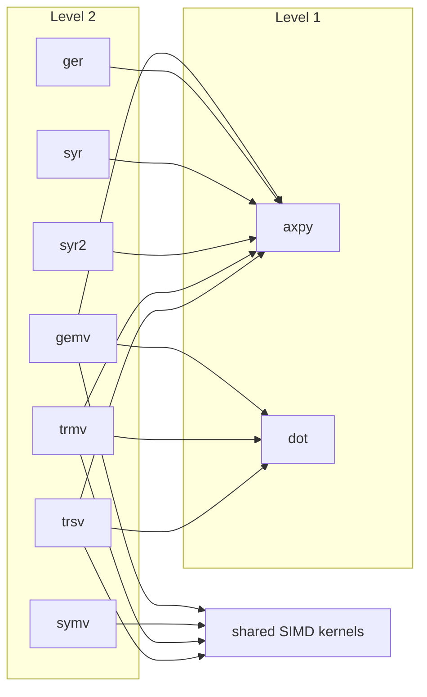

# L2

<!-- deps:begin -->
_Generated by `tools/depmap.mjs` from the source; the gate fails if this block and the code disagree. Do not edit by hand._

Families at this level and what each one's routines call, down to the leaves:

- **gemv**: `cgemv`, `dgemv`, `sgemv`, `zgemv`
- **ger**: `cgerc`, `cgeru`, `dger`, `sger`, `zgerc`, `zgeru`
- **symv**: `chemv`, `dsymv`, `ssymv`, `zhemv`
- **syr**: `cher`, `dsyr`, `ssyr`, `zher`
- **syr2**: `cher2`, `dsyr2`, `ssyr2`, `zher2`
- **trmv**: `ctrmv`, `dtrmv`, `strmv`, `ztrmv`
- **trsv**: `ctrsv`, `dtrsv`, `strsv`, `ztrsv`

<!-- deps:end -->
