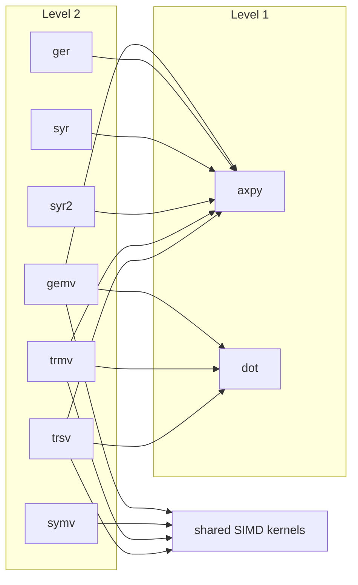

# Level 2 — matrix–vector operations

Seven families, one folder each, every routine in four number types
(`d` f64, `s` f32, `z` c64, `c` c32; the symmetric families carry the
Hermitian form in the complex types, and `ger` splits into the
unconjugated `geru` and the conjugated `gerc` as reference BLAS
does). Each folder's README is that family's chapter; this page is
the level's map and its scoreboard.

| family | operation | folder |
|---|---|---|
| gemv | $y \leftarrow \alpha\,\mathrm{op}(A)\,x + \beta y$ | `gemv/` |
| ger | $A \leftarrow A + \alpha x y^{T}$ (complex: $x y^{T}$ or $x y^{H}$) | `ger/` |
| symv | $y \leftarrow \alpha A x + \beta y$, $A$ symmetric or Hermitian, one triangle stored | `symv/` |
| syr | $A \leftarrow A + \alpha x x^{T}$, one triangle | `syr/` |
| syr2 | $A \leftarrow A + \alpha x y^{T} + \alpha y x^{T}$, one triangle | `syr2/` |
| trmv | $x \leftarrow \mathrm{op}(A)\,x$, $A$ triangular, in place | `trmv/` |
| trsv | $x \leftarrow \mathrm{op}(A)^{-1} x$, in place | `trsv/` |

Matrices are column-major with a leading dimension; vectors are
contiguous slices (strides are todo S3, gated by decision D7); the
flags are the enums `Trans`, `Uplo` and `Diag`; a failed precondition
returns an `Error` naming the argument. No Level 2 routine takes a
workspace.

## One shape, four columns at a time

Every Level 2 operation is, by definition, a loop of Level 1
operations over the columns of $A$: an `axpy` per column for the
products and the updates, a `dot` per column for the transposed
products. The level's one tuning idea is to run four columns through
one pass over the vector instead of four passes: the fan-in kernels
in `src/kernels.rs` (`daxpy4`, `daxpy4in` and their twins) read four
columns of $A$ and touch $y$ or $x$ once, cutting the vector's
read-modify-write traffic by four while performing, for every
element, exactly the roundings the one-column loop performs, in the
same order. That is why the tuned shapes are bit-identical to the
plain definitions and are tested as such. The two exceptions are the
symmetric matrix–vector products, whose fused pass serves both
triangles from one read of each column and therefore folds its
reduction in its own order (bounds-tested, not bit-locked), and the
transposed triangular products and solves, which are dot-fold
reductions per column and are locked to that fold.

Level 2 is memory-bound: each element of $A$ is read once and used
once, so the ceiling is the machine's memory stream, not its
arithmetic, and the scoreboard measures against the fastest same-run
stream.

## Scoreboard

n = 2048, percentage of the fastest same-run memory stream (a triad
or a copy, whichever the run measured faster), the range across two
runner draws from the July 2026 campaign record (the runs are named in
`bench/README.md`'s method section; the campaign record itself is in
the predecessor repository). These rows predate the K2 and K1
campaigns, which did not touch Level 2; a re-run at the current head is
owed when the Level 2 lever below is raced.

| routine | f64 | f32 | c64 | c32 |
|---|---|---|---|---|
| gemv | 57–64% | 59–64% | 50–56% | 60–63% |
| gemv_t (complex: also gemv_c) | 43–52% | 66–68% | 39–42% / 39–42% | 39–40% / 38–41% |
| ger (complex: geru / gerc) | 79–90% | 100% | 65–70% / 65–70% | 88–91% / 91–92% |
| symv (complex: hemv) | 53–54% | 48% | 16–21% | 12% |
| trmv | 60–66% | 54–59% | 47–52% | 60–65% |
| trsv | 59–65% | 53–57% | 47–53% | 54–56% |
| syr (complex: her) | 100% | 87–90% | 60–64% | 85–93% |
| syr2 (complex: her2) | 50–51% | 45–46% | 32–35% | 47–49% |

Read: the rank-1 updates run at the memory ceiling (they are pure
streams); the products and the triangular routines sit at 50–65%,
which is the cost of touching two vectors per column plus the
reductions' fold; the complex Hermitian matrix–vector product is the
weak row (`symv/README.md` says why and what was tried). There is no
comparison against OpenBLAS or BLIS for this level yet: the B0
harness measures Level 3 only, and adding Level 1 and 2 rows is a
recorded lever in `STATUS.md`.

## Dependencies

What each routine calls, generated from the source and checked by the
gate. The family READMEs carry the per-routine tables; this graph is
the level's view down to the leaves. "kernels" is `src/kernels.rs`,
the four-column fan-in loops and the fused symmetric passes.

<!-- deps:begin -->
_Generated by `tools/depmap.mjs` from the source; the gate fails if this block and the code disagree. Do not edit by hand._

Families at this level and what each one's routines call, down to the leaves:

- **gemv**: `cgemv`, `dgemv`, `sgemv`, `zgemv`
- **ger**: `cgerc`, `cgeru`, `dger`, `sger`, `zgerc`, `zgeru`
- **symv**: `chemv`, `dsymv`, `ssymv`, `zhemv`
- **syr**: `cher`, `dsyr`, `ssyr`, `zher`
- **syr2**: `cher2`, `dsyr2`, `ssyr2`, `zher2`
- **trmv**: `ctrmv`, `dtrmv`, `strmv`, `ztrmv`
- **trsv**: `ctrsv`, `dtrsv`, `strsv`, `ztrsv`

<!-- deps:end -->

## Where the rest is

- The per-routine pages (the module headers of the `.rs` files) carry
  what differs by type: the complex product form, the Hermitian
  conventions, the divisions.
- Tests: `tests/L2/`, one file per routine plus `semantics.rs` and
  `errors.rs`; the Level 2 rows of the table in `tests/README.md` say
  what each family is tested to.
- The measurement method and the instruments: `bench/README.md`.
