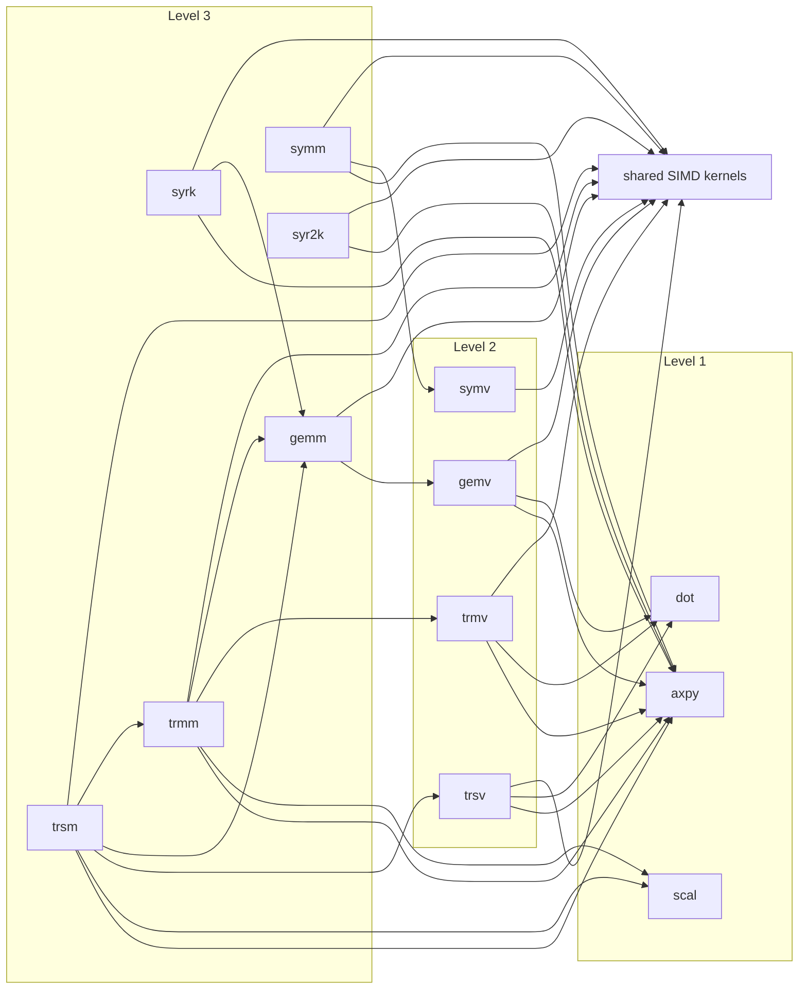

# Level 3 — matrix–matrix operations

Six families, one folder each, every routine in four number types
(`d` f64, `s` f32, `z` c64, `c` c32; the symmetric families also carry
the complex-symmetric form beside the Hermitian one, as reference BLAS
does). Each folder's README is that family's chapter: what the
operation is, how it is computed and why, what it calls, and how fast
it runs against the two named competitors. This page is the level's
map and its scoreboard.

| family | operation | folder |
|---|---|---|
| gemm | $C \leftarrow \alpha\,\mathrm{op}(A)\,\mathrm{op}(B) + \beta C$ | `gemm/` |
| symm | $C \leftarrow \alpha A B + \beta C$ or $\alpha B A + \beta C$, $A$ symmetric or Hermitian | `symm/` |
| syrk | $C \leftarrow \alpha\,\mathrm{op}(A)\,\mathrm{op}(A)^{T} + \beta C$, one triangle of $C$ | `syrk/` |
| syr2k | $C \leftarrow \alpha(\mathrm{op}(A)\,\mathrm{op}(B)^{T} + \mathrm{op}(B)\,\mathrm{op}(A)^{T}) + \beta C$, one triangle | `syr2k/` |
| trmm | $B \leftarrow \alpha\,\mathrm{op}(A)\,B$ or $\alpha B\,\mathrm{op}(A)$, $A$ triangular, in place | `trmm/` |
| trsm | $B \leftarrow \alpha\,\mathrm{op}(A)^{-1} B$ or $\alpha B\,\mathrm{op}(A)^{-1}$, in place | `trsm/` |

Every matrix is column-major with its own leading dimension; the
flags are the enums `Trans`, `Side`, `Uplo` and `Diag`; a failed
precondition returns an `Error` naming the argument; and gemm, syrk,
syr2k, trmm and trsm take a trailing `work` slice sized by their
`*_work` query, because the crate never allocates.

## One packing layer

The level's design after the K2 and K1 campaigns is one idea applied
five times. The real-type gemm runs the BLIS/Goto shape: $A$ and $B$
are packed into contiguous panels per $k$-block ($K_C = 256$,
$M_C = 128$), and a register-tile micro-kernel ($4 \times 4$ in f64,
$8 \times 4$ in f32) runs over the panels with $\alpha$ folded into
$B$'s panel at pack time and $B$'s values broadcast by lane shuffles,
so the inner loop is loads, multiplies and adds and nothing else.
syrk, trmm and trsm in the real types run their off-diagonal work
through that same tile and keep their diagonal blocks in small lane
routines, each in the term order its original column sweep used, so
the results are bit-for-bit the sweeps' (the sweeps stay exported as
`*_sweep` and are the tests' references). symm and syr2k, and every
complex routine but gemm, still run the column sweeps: four columns
at a time through the shared kernels in `src/kernels.rs`. The complex
gemms run a fused four-column stream below a size threshold and their
own packed complex tile above it. The taxonomy codes for all of this
are in `DESIGN.md`, "Kernels".

What is **not** in the inner loops anywhere: fused multiply-add. The
relaxed-SIMD instruction rounds differently on different hardware,
and the crate's first claim is that results are bit-identical
everywhere, so every multiply and add rounds separately. This halves
the arithmetic ceiling against libraries that fuse; it is the price
of the claim, recorded as constraint 2 in `DESIGN.md`.

## Scoreboard

Two kinds of numbers, both from the GitHub runners (`bench.yml`), two
draws each, every verdict a same-run ratio because the runner pool's
speed varies by up to 1.5× between runs.

**Against OpenBLAS and BLIS compiled to WebAssembly**, run in the same
Node on the same runner, single-threaded, no relaxed SIMD anywhere
(method: `bench/README.md`, "B0"). Milliseconds per call, min over
the iterations and over two interleaved rounds, the range across runs
40232073684 and 40232628850; the ratio columns are this crate's time
over theirs, so above 1 means this crate is slower.

| op | blas.wasm | OpenBLAS-wasm | BLIS-wasm | ours ÷ OpenBLAS | ours ÷ BLIS |
|---|---|---|---|---|---|
| dgemm 512³ | 17.5–19.1 | 17.5–18.2 | 31.5–35.0 | 1.00–1.05 | 0.54–0.56 |
| sgemm 512³ | 9.0–9.1 | 7.9–8.3 | 13.4–13.9 | 1.11–1.15 | 0.66–0.67 |
| zgemm 512³ | 79.9–81.1 | 83.8–86.3 | 84.6–91.1 | 0.94–0.95 | 0.89–0.94 |
| cgemm 512³ | 41.5–45.3 | 63.6–69.7 | 132.8–134.0 | 0.65 | 0.31–0.34 |
| dsymm left 512 | 21.9–23.2 | 17.7–18.3 | 36.5–40.7 | 1.24–1.27 | 0.57–0.60 |
| dsyrk 512 | 9.2–9.9 | 9.2–9.4 | 18.9–19.2 | 0.99–1.05 | 0.49–0.51 |
| dtrmm left 512 | 10.4–11.3 | 9.0–9.2 | 14.1–15.5 | 1.16–1.23 | 0.73 |
| dtrsm left 512 | 11.4–12.5 | 9.9–10.2 | 17.0–18.5 | 1.15–1.22 | 0.67–0.68 |
| dgemm 1024³ | 142.3–151.1 | 140.6–144.3 | 291.9–334.7 | 1.01–1.05 | 0.45–0.49 |
| sgemm 1024³ | 72.3–73.1 | 62.0–62.5 | 106.7–110.9 | 1.17 | 0.66–0.68 |
| zgemm 1024³ | 642.8–644.7 | 668.7–686.4 | 667.4–722.0 | 0.94–0.96 | 0.89–0.96 |
| cgemm 1024³ | 314.9–330.9 | 506.3–556.8 | 1060.8–1071.8 | 0.59–0.62 | 0.29–0.31 |

Read: this crate ties OpenBLAS-wasm on dgemm and dsyrk, trails it by
11–17% on sgemm, 15–23% on dtrmm and dtrsm and 24–27% on dsymm, leads
it on zgemm and cgemm, and leads BLIS's generic build on every row.
Before the K2 and K1 campaigns (runs 40220022112 / 40220778110, head
`6af68df`) the real-type rows were 1.9–2.3× behind OpenBLAS. What
remains, and what would close it, is in each family's README and in
`STATUS.md` under "Levers".

**Against the machine**, n = 512, as a percentage of the same run's
arithmetic-peak probe (runs 40232849090 and 40233130801, two runners
whose f64 probes read 14.9 and 22.4 GFLOP/s; each complex type scores
against its own precision's real peak, a complex multiply-add
counting 8 real FLOPs):

| routine | f64 | f32 | c64 | c32 |
|---|---|---|---|---|
| gemm | 102–107% | 103–109% | 92–95% | 84–101% |
| symm_left (complex: hemm_left) | 81–98% | 75–95% | 60–79% | 60–76% |
| syrk (complex: herk) | 98–102% | 99–110% | 72–95% | 76–94% |
| syr2k (complex: her2k) | 38–49% | 47–56% | 71–92% | 74–92% |
| trmm_left | 86–92% | 89–103% | 77–94% | 75–92% |
| trsm_left | 78–89% | 82–92% | 77–93% | 75–90% |
| trmm_right | 96–100% | 97–111% | 78–97% | 85–102% |
| trsm_right | 94–96% | 94–104% | 77–97% | 86–101% |

**The percentages above 100% are a defect of the instrument, not a
result.** The peak probe (`run_ceiling_flops` in `bench/src/lib.rs`)
keeps its multiply on the accumulator's dependency chain, so it
measures a latency bound that the packed kernel, whose multiplies are
off the chain, exceeds by up to 11%. It is bug B1 in `STATUS.md`;
until it is fixed this column says how the rows stand to each other
and to the gemm kernel, not to the machine. What the table does show:
the real gemm, syrk, trmm and trsm run within about 10% of each other
(trsm_left the slowest, its diagonal solve on lanes), syr2k is the one
real row still on the column sweep, and the symm/hemm_left rows ride
their Level 2 kernels.

## Dependencies

What each routine calls, generated from the source and checked by the
gate. The family READMEs carry the per-routine tables; this graph is
the level's view down to the leaves. An edge from a Level 3 family to
`gemm` is the packed tile; an edge to a Level 2 or Level 1 family is a
column sweep or a reference shape (every family keeps its plain
column-axpy reference exported and bit-checked, and those references
call the Level 2 routines). "kernels" is `src/kernels.rs`, the blocked
SIMD loops several families share.

<!-- deps:begin -->
_Generated by `tools/depmap.mjs` from the source; the gate fails if this block and the code disagree. Do not edit by hand._

Families at this level and what each one's routines call, down to the leaves:

- **gemm**: `cgemm`, `dgemm`, `sgemm`, `zgemm`
- **symm**: `chemm`, `csymm`, `dsymm`, `ssymm`, `zhemm`, `zsymm`
- **syr2k**: `cher2k`, `csyr2k`, `dsyr2k`, `ssyr2k`, `zher2k`, `zsyr2k`
- **syrk**: `cherk`, `csyrk`, `dsyrk`, `ssyrk`, `zherk`, `zsyrk`
- **trmm**: `ctrmm`, `dtrmm`, `strmm`, `ztrmm`
- **trsm**: `ctrsm`, `dtrsm`, `strsm`, `ztrsm`

<!-- deps:end -->

## Where the rest is

- The per-routine pages (the module headers of the `.rs` files) carry
  what differs by type: tile geometry, thresholds, the complex
  arithmetic's conventions.
- Tests: `tests/L3/`, one file per routine plus `semantics.rs` (the
  reference's α, β and k = 0 rules) and `errors.rs`; what each family
  is tested to is the Level 3 table in `tests/README.md`.
- The measurement method, the instruments and the whole-board B0
  harness: `bench/README.md`.
