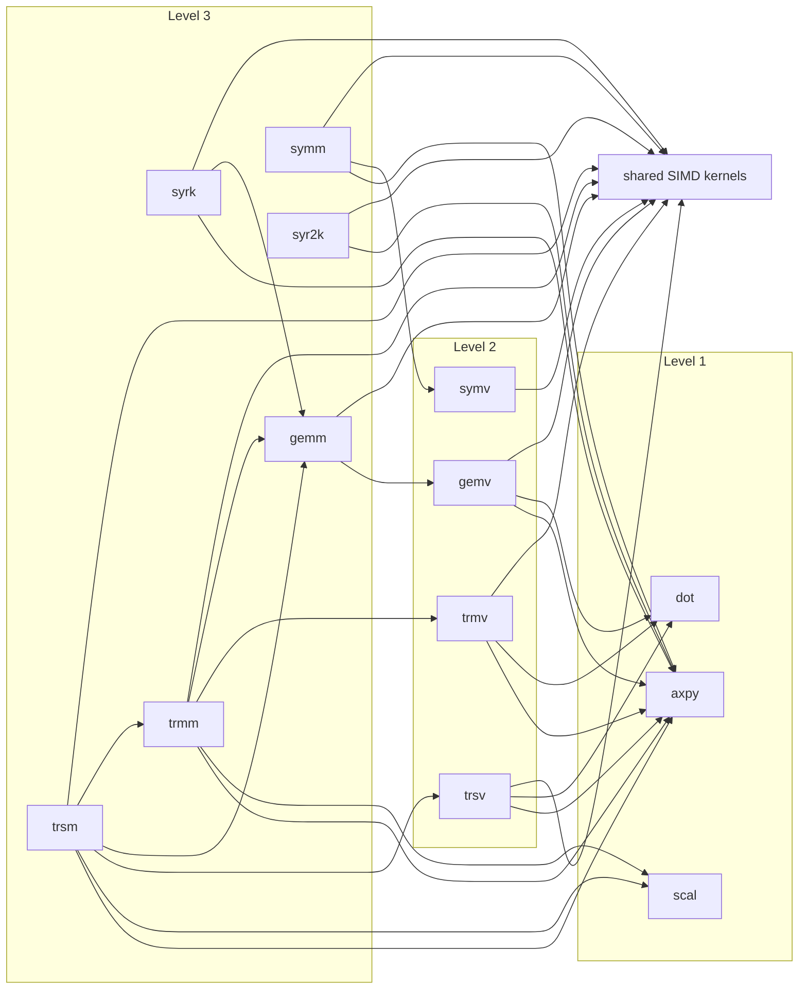

# L3

<!-- deps:begin -->
_Generated by `tools/depmap.mjs` from the source; the gate fails if this block and the code disagree. Do not edit by hand._

Families at this level and what each one's routines call, down to the leaves:

- **gemm**: `cgemm`, `dgemm`, `sgemm`, `zgemm`
- **symm**: `chemm`, `csymm`, `dsymm`, `ssymm`, `zhemm`, `zsymm`
- **syr2k**: `cher2k`, `csyr2k`, `dsyr2k`, `ssyr2k`, `zher2k`, `zsyr2k`
- **syrk**: `cherk`, `csyrk`, `dsyrk`, `ssyrk`, `zherk`, `zsyrk`
- **trmm**: `ctrmm`, `dtrmm`, `strmm`, `ztrmm`
- **trsm**: `ctrsm`, `dtrsm`, `strsm`, `ztrsm`

<!-- deps:end -->
