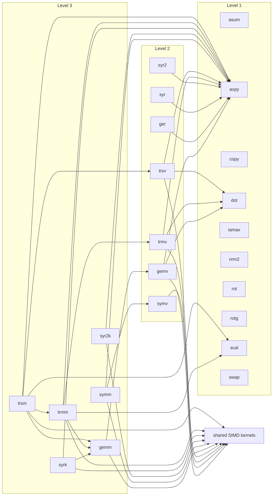

# src/ — the map of the source

Three levels, one folder each (`L1/`, `L2/`, `L3/`), and inside each
level one folder per BLAS operation family (`L3/gemm/`, `L2/symv/`,
`L1/axpy/`, …) holding that operation in every number type, one file
per routine in netlib naming (`dgemm.rs`, `sgemm.rs`, `zgemm.rs`,
`cgemm.rs`). Every folder has a README that is also its page in the
book (`cargo doc --open`): a level's README is the level's map and
scoreboard, a family's README is the family's chapter — what the
operation is, how it is computed, what it calls, how it performs.
Beside the levels: `kernels.rs` (the blocked SIMD loops several
families share), `lanes.rs` (the two lane types whose native
emulation makes native and wasm bit-identical), `c64.rs`/`c32.rs`
(the complex scalars), `error.rs`, `flags.rs`, `math.rs` (the four
vendored math functions) and `book/` (chapters that belong to no
routine).

## Who calls whom

Generated from the source by `tools/depmap.mjs` and checked by the
gate on every push, so this graph is the code's, not a drawing of it.
One node is one operation family; an edge means a routine in the
family calls a free function in the other. The family READMEs have the
per-routine tables with the function names; the level READMEs have
each level's view. Not drawn: the lane types, the argument checks and
the small helpers in each level's `mod.rs` (`transpose_into`, the
`*scale_y` and `*sym_at`/`*her_at` accessors), which every family uses.

<!-- deps:begin -->
_Generated by `tools/depmap.mjs` from the source; the gate fails if this block and the code disagree. Do not edit by hand._

<!-- deps:end -->

Reading the graph: an edge from a Level 3 family to `gemm` is the
packed micro-kernel the real-type syrk, trmm and trsm share with gemm
since the K1 campaign; an edge from a Level 3 family to a Level 2
family is the plain reference shape or the complex sweep (a
matrix–vector product per column); the Level 1 families are leaves
except that the complex routines marked as delegations below call
their real twins.

## The complex layers (z- and c-routines) — same graph, renamed nodes

The two complex layers (c64 z-prefixed, c32 c-prefixed — identical
structure) are the same picture with node substitutions — **30
routines / 36 operations** each (counting convention: crate README):

- *Splits*: `dot` → `dotu` + `dotc` (unconjugated/conjugated are
  different results); `ger` → `geru` + `gerc`; `gemv` gains a third
  form `gemv_c` (y ← αAᴴx, one `dotc` per column) beside `gemv` and
  `gemv_t`; `scal` gains the real-α `dscal` form.
- *Renames*: the symmetric family becomes Hermitian — `symv` → `hemv`
  (fused, no outgoing arrows, same as symv), `syr`/`syr2` →
  `her`/`her2`, `symm` → `hemm`, `syrk` → `herk`, `syr2k` → `her2k` —
  with the same edges as their real twins — and exists a second time
  unconjugated: `symm`/`syrk`/`syr2k` (reference `zsymm`, `zsyrk`,
  `zsyr2k`), the same edges again, beside the Hermitian nodes.
- *Delegations, not nodes*: copy/swap/rot/the real-α scal/nrm2/asum
  are one-line calls to the tuned same-precision real routines on the
  interleaved 2n-real view (`c64.rs`/`c32.rs`) — they inherit the
  real stream's speed, guards, and determinism rather than
  duplicating the loops (c64: zcopy/zswap/zdrot/zdscal/dznrm2/dzasum;
  c32: ccopy/cswap/csrot/csscal/scnrm2/scasum).
- `rot` exists twice: the real-c,s form (`zdrot`/`csrot`) delegates
  as above, and `zrot`/`crot` (real c, complex s) are nodes of their
  own, the scalar definition per element with no fold; `zrotg`/`crotg`
  generate the complex Givens (c real, s complex).

## Routine naming — the netlib convention (applies to L1/, L2/, L3/)

One file per BLAS routine per number type, named exactly as the
reference BLAS names them — the layout of the netlib source tree.
The file name is the function it exports: `daxpy.rs` exports
`pub fn daxpy`.

### The type prefix

The first letter encodes the number type, matching the columns of the
tables in the crate README:

| prefix | type | example |
|---|---|---|
| `d` | f64 (double) | `daxpy`, `dgemm` |
| `s` | f32 (single) | `saxpy`, `sgemm` |
| `z` | c64 (double complex) | `zaxpy`, `zgemm` |
| `c` | c32 (single complex) | `caxpy`, `cgemm` |

The index routines put `i` first and the type second: `idamax` /
`isamax` / `izamax` / `icamax` (index of the largest element — |x|
for real, |re|+|im| for complex). The complex routines that return a
real carry both letters, exactly as reference BLAS spells them:
`dznrm2`/`scnrm2`, `dzasum`/`scasum`; and the real-scalar/
real-rotation forms keep reference names too: `zdscal`/`csscal`
(real α), `zdrot`/`csrot` (real c, s).

### Where we deviate from reference BLAS — deliberately, per routine

The names are netlib's; the signatures are ours (documented per file):

- **Flags are enums, errors are values.** The character arguments
  `TRANS`, `SIDE`, `UPLO`, `DIAG` are the enums `Trans`, `Side`,
  `Uplo`, `Diag` with netlib meanings, in netlib argument order; every
  routine with a checkable precondition returns `Result<(), Error>`
  with the routine and the argument position, instead of calling
  `xerbla`. Inside each file the public routine validates and calls a
  crate-private kernel, the `*_k` function (one per flag form:
  `dgemv_k`, `dgemv_t_k`, `dsymm_left_k`, …), which is the tuned body
  and asserts its preconditions as a backstop.
- **A trailing `work` slice** on gemm, the syrk family, trmm and trsm,
  sized by the routine's `*_work` query (zero where the routed shape
  needs none); reference BLAS has no workspace arguments because it
  allocates nothing, and this crate allocates nothing either — the
  kernels that pack (`*gemm_packed`, with their own `*gemm_packed_work`
  query) take the slice too.
- **Netlib quick returns on dimensions.** After the argument checks, a
  zero `m` or `n` returns `Ok` with nothing written; gemm with `k = 0`
  scales `C` by `β`. `alpha == 0` reads neither operand and `beta ==
  0` never reads the output, as reference BLAS (tested with
  NaN-poisoned operands).
- **Unit stride only.** Callers pass contiguous column slices with a
  column stride per matrix — no `incx`/`incy` today. Strides are
  planned (`../STATUS.md`, todo S3; the API shape is decision D7).
- **`drotg`/`srotg` return a `Givens` struct** (c, s, r) instead of
  writing through pointers, and omit the classic `z` reconstruction
  output — no consumer wants it. `zrotg` likewise returns a `ZGivens`
  (real c, complex s, complex r).
- **Tuned-variant exports.** Where a routine ships raced alternates,
  they carry a suffix: `dgemm_colaxpy` (the plain reference shape),
  `dgemm_tiled`, `dgemm_col4`, `dgemm_packed` (the pre-K2 kernel) and
  `dgemm_packed_bcast` (the shipping one), and the s twins — `dgemm`
  itself validates and routes. z/c export `*gemm_colaxpy`,
  `*gemm_col4` and `*gemm_packed`; their packed shape is the complex
  register tile. The K1 pairs: `*syrk_packed` / `*syrk_sweep`,
  `*trmm_left_packed` / `*trmm_left_sweep`, `*trmm_right_packed` /
  `*trmm_right_sweep`, `*trsm_left_packed` / `*trsm_left_sweep`,
  `*trsm_right_packed` / `*trsm_right_sweep` in d and s, each packed
  shape with its `*_work` query; the sweeps are the shapes that shipped
  before the race. The alternates take `(alpha, m, n, k, a, lda,
  b, ldb, beta, c, ldc)`, no flags, and assert rather than return
  errors: they are kernels, exported so the tests and the benchmarks
  can race them. The transposed-form candidates follow the same rule:
  `*gemm_copy_op` and `*gemm_packed_op` (flags, then the kernel
  arguments, then `work`, sized by `*gemm_copy_op_work` /
  `*gemm_packed_op_work`),
  `*trmm_copy`/`*trsm_copy` (the netlib arguments plus `work`, sized
  by `*_copy_work`) and `*trmm_stream`/`*trsm_stream` (the netlib
  arguments, no workspace).

Everything else about a routine — what it computes, its rounding
contract, which tuned loop shape it ships and why — lives in its own
file's module docs. The per-level composition rules are in each
level's `mod.rs`; who-calls-whom is the graph above.
